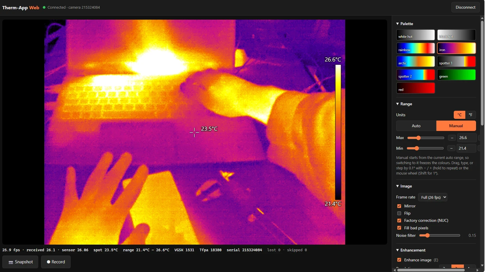
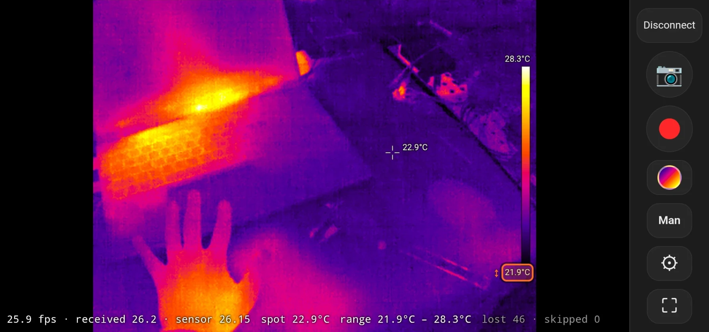

# ThermApp Web

A browser app for the **Opgal Therm-App** USB thermal camera. It talks to the camera directly over **WebUSB**, applies the camera's own factory calibration, and shows live, radiometric thermal video in °C or °F. It runs in Chrome and Edge on Windows and Android, needs no Opgal software or native code, and installs nothing beyond a one-time USB driver on Windows.

The original Android apps for this camera are no longer maintained, ship only 32-bit native code (so they don't run on 64-bit-only phones), and depended on an Opgal server for calibration downloads that no longer exists. This project reimplements everything from the USB protocol up.

## ▶ [Open the app: benkrasnow.github.io/ThermApp-webapp/web/](https://benkrasnow.github.io/ThermApp-webapp/web/)

Open the link in **Chrome** (Android or desktop) or **Edge** (Windows), plug in the camera and tap **Connect**. It works right in the browser tab. Tap **⤓ Install app** in the header to get a home-screen or desktop icon that opens full-window and also works offline. You'll need your camera's calibration files ([step 1](#1-you-need-your-cameras-calibration-files)) and, on Windows, a one-time USB driver ([step 2](#2-windows-edge-or-chrome)).

**Desktop (Edge on Windows 11):**



**Android (installed app on a Pixel 6, landscape):**



## Tested on

| Platform | Browser | Notes |
|---|---|---|
| Windows 11 laptop | **Microsoft Edge 154.0.4258.53** | Needs the WinUSB driver (Zadig), installed once per PC |
| Google Pixel 6, Android 16 | **Chrome 157.0.8103.38** | Camera on the phone's USB-C port (USB OTG); installed as an app (PWA) both from the hosted site and over wireless debugging; runs without the PC; calibration folder imported on the phone |

**Camera:** the original Therm-App (384×288, non-TH), hardware 4, firmware 118.

Chrome or Edge on macOS, Linux and ChromeOS should also work, since they all support WebUSB, but they haven't been tested. **Firefox, Safari and iOS can't work, because they don't support WebUSB.**

---

## Installation

### 1. You need your camera's calibration files

Every Therm-App has per-camera factory calibration files. Opgal's apps downloaded them from a server that no longer exists, so **the only copies are on phones where an old Therm-App app has run with your camera.** Copy this folder off that phone and keep a backup:

```
/sdcard/ThermApp/<your camera's serial number>/
```

It contains `0.bin`–`11.bin` and `FilesList.json`. You can copy it with a USB file transfer, or with adb:

```bash
adb pull /sdcard/ThermApp/<serial> calibration/
```

Without these files the app still shows an image, but it's uncorrected and has no temperatures.

### 2. Windows (Edge or Chrome)

1. **Install the WinUSB driver (once per PC).** The camera is a vendor-specific USB device, so Windows needs a generic driver before a browser can open it.
   1. Plug in the Therm-App.
   2. Download and run **[Zadig](https://zadig.akeo.ie/)**.
   3. Choose **Options → List All Devices**.
   4. Select **"USB2.0"** in the drop-down and check that the USB ID reads **1772 0002**.
   5. Set the target driver to **WinUSB** and click **Install Driver** (or **Replace Driver**).
2. **Quickest: use the hosted app.** Open **[https://benkrasnow.github.io/ThermApp-webapp/web/](https://benkrasnow.github.io/ThermApp-webapp/web/)** in Edge and skip to step 4. To run your own copy instead, get the code: `git clone https://github.com/benkrasnow/ThermApp-webapp.git`, or download the ZIP from GitHub.
3. **Serve it locally** (own copy only). WebUSB needs a secure address (`https://`, or `http://localhost`), so the page can't be opened as a file.
   - **Easiest:** double-click **`serve.bat`**. It needs [Python 3](https://www.python.org/downloads/), starts a server on port 8765 and opens Edge.
   - **Or from any terminal:** run `python -m http.server 8765` in the repo folder, then open **http://localhost:8765/web/**.
4. Click **Connect camera** and choose **USB2.0** in the browser's device picker.
5. **Load your calibration.** Either:
   - put your calibration folder in `calibration/<serial>/` in the repo before starting, so it loads automatically; or
   - use **Calibration → Import calibration folder…** in the app.

   Either way it's then stored in the browser, so you only do this once.
6. **Optional:** install it as a desktop app, using **⤓ Install app** in the header or Edge's address-bar install icon. That gives you a Start-menu entry, and it runs without `serve.bat` afterwards.

### 3. Android (Chrome): install as an app

On Android, the app installs from Chrome as a **Progressive Web App (PWA)**. That gives you a home-screen icon that opens full-window like a normal app and **keeps working with no PC and no internet**. Once installed, you plug the camera in, tap the icon, and tap **Connect** if it doesn't connect by itself.

The phone needs USB host (OTG) support, which most modern phones have. The camera plugs into the phone's USB port, and no driver is needed. The phone loads the app once from a *secure* address, either `https://…` (the hosted app) or `http://localhost` (over debugging), and installs it from there.

#### Option A (easiest): install from the hosted app

1. **On the phone:** open **[https://benkrasnow.github.io/ThermApp-webapp/web/](https://benkrasnow.github.io/ThermApp-webapp/web/)** in Chrome.
2. Tap **⤓ Install app** in the header, or use Chrome's menu → **Install app**, and confirm. A **Therm-App** icon appears on the home screen. You can also just use the page in the browser tab, but the installed app opens full-window and works offline.
3. **Calibration:** get your camera's calibration folder onto the phone, for example over a USB file transfer into **Download**. If the old Therm-App app ran on this same phone, it's already at `/sdcard/ThermApp/<serial>/`.
4. Plug in the camera, launch the app, and tap **Connect** → **USB2.0** → allow. Then use **Settings → Calibration → Import calibration folder…**, or **Pick the files instead…** and select `0.bin`–`11.bin`. This is needed only once per camera. Tested on the Pixel 6: Chrome's folder picker asks permission to "upload" the files, but they are only read inside the app.

The installed app updates itself whenever the phone is online and works offline otherwise. Calibration is never uploaded anywhere: it is read on the phone and stored in the app's local storage.

To **host your own copy**, fork this repository and enable **Settings → Pages** (deploy from branch `main`, folder `/ (root)`). The app is then at `https://<your-user>.github.io/ThermApp-webapp/web/`. Netlify, Cloudflare Pages or any HTTPS server work the same way.

#### Option B: install over Android debugging (no internet needed, or your own copy)

Use this if you want to install your own copy of the code, or the phone has no internet. It uses the PC from step 2 to serve the app to the phone one time. `adb reverse` makes the PC's server appear as `localhost` on the phone, which Chrome treats as secure. Wireless debugging is recommended, because the camera can then be plugged into the phone during setup, and its calibration loads straight from the PC.

1. **On the PC:** clone the repo, put your calibration folder in `calibration/<serial>/`, start the server (`serve.bat`, or `python -m http.server 8765`), and install [Android platform-tools](https://developer.android.com/tools/releases/platform-tools) (`adb`).
2. **On the phone:** enable **Developer options** by tapping **Settings → About phone → Build number** seven times. Then turn on **Developer options → Wireless debugging**, and note the IP address and port it shows. If the PC hasn't connected to this phone before, use **Pair device with pairing code** once and run `adb pair <ip>:<pairing-port>`.
3. **On the PC**, run:
   ```bash
   adb connect <phone-ip>:<port>
   ```
   ```bash
   adb reverse tcp:8765 tcp:8765
   ```
4. **On the phone:** open **`http://localhost:8765/web/`** in Chrome and tap **⤓ Install app** in the header, or use Chrome's menu → **Install app**. Confirm. A **Therm-App** icon appears on the home screen.
5. Plug in the camera and launch the app from the icon. Tap **Connect**, choose **USB2.0** and allow Android's USB prompt. The app reads the camera's serial number and loads its calibration from the PC. From then on, the calibration is stored on the phone.
6. **Done.** Turn off wireless debugging and unplug or close the PC; the app keeps working on its own.

You can use a USB cable instead of wireless debugging: turn on **USB debugging** and run `adb reverse` over the cable. The phone's port is then busy during setup, so copy the calibration files onto the phone first (`adb push calibration/<serial> /sdcard/Download/`), and after setup import them in the app (**Settings → Calibration → Pick the files instead…**, then select `0.bin`–`11.bin`).

**To update** the installed app later: pull the latest code, run `adb reverse` again and open the app. It fetches the new files whenever the PC is reachable.

#### How the installed app works

- **Install button:** **⤓ Install app** appears in the header only when the browser offers installation. It's hidden when the app is already running as the installed app.
- **Manifest:** `web/manifest.webmanifest` gives the app its name, icon and standalone window. Chrome uses it to offer **Install**.
- **Service worker:** `web/sw.js` copies every app file into the browser's cache at install time. Each later request tries the network first, with a 2.5-second timeout, and falls back to the cached copy. When the PC or website is reachable you get the latest version, and when it isn't, the app starts from the cache.
- **Persistent storage:** the app asks the browser to keep its storage. That holds the cached app, the calibration, the dark frames and the settings, so Android shouldn't clear them under storage pressure.
- **USB access:** Chrome remembers your permission for the camera. When the app starts with the camera attached, or the camera is plugged in while the app is open, it connects automatically. If Android has forgotten the permission (for example after replugging), tap **Connect** again.
- **Uninstalling or clearing data:** uninstalling the app or clearing Chrome's data for the site can delete the stored calibration. Keep your own backup of the calibration folder.
- **Limitation:** a web app can't make Android launch it automatically when the camera is plugged in, so you still tap the icon.

**If you used an old Therm-App app on this phone:** Android may have it saved as the default app for the camera. Then every time you plug the camera in, Android opens that app and gives the camera only to it, and this app gets **"Access denied"** with no permission popup. Swiping the old app away doesn't help. Clear the default once:
1. Go to **Settings → Apps → ThermAppPlus** (or the old Therm-App app).
2. Tap **Open by default → Clear default preferences**.
3. Re-plug the camera; if Android asks which app to open, dismiss it.
4. In this app, tap **Connect**, choose **USB2.0**, and allow access.

Uninstalling the old app also works. Your calibration folder in `/sdcard/ThermApp/` stays, but back it up first anyway.

---

## Features

- **Live video** at the sensor's full 25.98 fps, with the factory non-uniformity correction (NUC), bad-pixel repair and Opgal's exact VGSK bias loop (needed for correct temperatures).
- **Temperatures** in °C or °F with one decimal: spot meter (tap or click to move), min/max markers, and a colour bar.
- **Range:**
  - **Auto** (percentile, smoothed) or **Manual**, with sliders, typed values, − / + steppers and the mouse wheel.
  - On touch screens: tap the colour bar's max or min, then swipe on the image to adjust it.
- **The original app's 9 palettes:** white hot, black hot, rainbow, iron, arctic, two spotter palettes, green, red.
- **Dark-frame (flat-field) correction:** cover the lens, capture, and per-pixel offsets and gradients are removed without shifting absolute temperatures.
- **GPU enhancement:**
  - edge-preserving denoise (guided filter);
  - halo-free detail enhancement (DDE-style, noise-gated);
  - 2×/3×/4× output with Lanczos, bicubic, bilinear or nearest interpolation.

  Measurements always use the unenhanced data.
- **Optional temporal noise filter,** and selectable camera frame rate (1–26 fps).
- **Snapshots:**
  - PNG of the view;
  - optional 32-bit float TIFF of every pixel's temperature in °C;
  - optional raw USB frame.
- **Video:**
  - MP4 (VP9, colour-accurate, the default), MP4 (H.264) or WebM, with Standard, High or Maximum quality;
  - streams to a folder you choose, with exact per-frame capture and a dropped-frame warning;
  - the recording time and size badge isn't burned into the video.
- **Layouts:** a desktop layout, plus automatic touch layouts for phones and tablets: a landscape camera view with a control rail and settings drawer, and portrait with tabs.
- **Screen wake lock** while connected on phones, and while recording.
- **Installable app (PWA):** a home-screen or desktop icon, a full-window app, and offline operation after one install. Updates arrive automatically when the source is reachable.

## Documentation

| Document | Contents |
|---|---|
| [docs/therm-app-protocol.md](docs/therm-app-protocol.md) | **Engineering notes:** the USB protocol, all 32 configuration words, the frame format, frame-rate behaviour, calibration file formats, the NUC formula, Opgal's VGSK bias loop, an inventory of the native libraries, an experiment log, open questions and safety notes |
| [calibration/README.md](calibration/README.md) | Working notes for the tested camera: file contents, NUC formula, temperature scale, VGSK loop, frame rate |
| [web/README.md](web/README.md) | Web app internals: module layout, data flow, display enhancement, dark frame, video recording measurements, touch layout, tests |
| [docs/feasibility.md](docs/feasibility.md) | The original feasibility study, from decompiling the old app and surveying existing projects |
| [docs/webapp-plan.md](docs/webapp-plan.md) | The original plan for the browser app |
| [prototype/README.md](prototype/README.md) | The Python + libusb prototype (superseded, used to generate test references) |

## Repository layout

```
web/                 The app: plain ES modules, no build step (edit and reload)
  index.html, app.css
  manifest.webmanifest, sw.js, icons/   Installable-app (PWA) manifest, offline service worker, icons
  js/                main, worker (USB + processing), usb, protocol, calibration,
                     processing, enhance (WebGL2), view, capture, palettes
  test/              golden.html (JS vs Python), video-quality.html, video-frames.html
docs/                Protocol document, feasibility study, plan, screenshots (docs/images)
calibration/         Calibration notes and the tested camera's calibration files (see below)
prototype/           Python/libusb prototype and the frames used by the golden tests
serve.bat            Local web server + Edge launcher for Windows
```

## Tests

With the local server running:
- **http://localhost:8765/web/test/golden.html** checks the JavaScript port against the Python prototype on saved frames: NUC (exact), bad pixels, VGSK loop, dark frame, and frame sync with padding and truncation. Expected result: **ALL PASSED**.
- **web/test/video-frames.html** checks that recordings keep every frame.
- **web/test/video-quality.html** measures recording fidelity for each codec and bitrate.

## Safety and caveats

- The camera and its calibration files are irreplaceable. Back up the calibration folder before experimenting.
- The configuration block includes detector bias voltages. Don't change config words to values the original software never sent; see the safety notes in the protocol document.
- Temperatures assume emissivity 1.0, and the absolute accuracy is whatever Opgal's factory calibration gives (the published NETD is about 70–100 mK). Treat readings as indicative, not certified.
- Only the 384×288 non-TH model has been tested. TH (thermography) and 640×480 models are described in the docs from the SDK code, but aren't supported yet.

## Acknowledgements

- **Pidbip/ThermAppCam** (Alexander G., GPLv3) did the original USB reverse-engineering, and its forks EFraim/ThermAppCam, Hacks4ROS/h4r_thermapp_camera and oil3/therm-app-mac continued it. This project shares no code with them; their notes independently confirmed several protocol details.
- The guided filter is from He, Sun & Tang, *Guided Image Filtering*.

This project isn't affiliated with or endorsed by Opgal. "Therm-App" is a trademark of Opgal Optronic Industries Ltd. No Opgal or ThermAppPlus code or binaries are included. The documentation describes observed behaviour and algorithms only.

## License

[MIT](LICENSE) © 2026 Ben Krasnow
