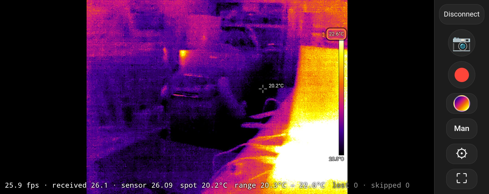

# ThermApp Web

A browser app for the **Opgal Therm-App** USB thermal camera. It talks to the camera directly over **WebUSB**, applies the camera's own factory calibration, and shows live, radiometric thermal video in °C or °F. It runs in Chrome and Edge on Windows and Android, needs no Opgal software or native code, and installs nothing beyond a one-time USB driver on Windows.

The original Android apps for this camera are no longer maintained, ship only 32-bit native code (so they don't run on 64-bit-only phones), and depended on an Opgal server for calibration downloads that no longer exists. This project reimplements everything from the USB protocol up.



## Tested on

| Platform | Browser | Notes |
|---|---|---|
| Windows 11 laptop | **Microsoft Edge 154.0.4258.53** | Needs the WinUSB driver (Zadig), installed once per PC |
| Google Pixel 6, Android 16 | **Chrome 157.0.8103.38** | Camera on the phone's USB-C port (USB OTG) |

**Camera:** the original Therm-App (384×288, non-TH), hardware 4, firmware 118.

Chrome or Edge on macOS, Linux and ChromeOS should also work, since they all support WebUSB, but they haven't been tested. **Firefox, Safari and iOS can't work, because they don't support WebUSB.**

---

## Installation

### 1. You need your camera's calibration files

Every Therm-App has per-camera factory calibration files. Opgal's apps downloaded them from a server that no longer exists, so **the only copies are on phones where an old Therm-App app has run with your camera.** Copy this folder off that phone and keep a backup:

```
/sdcard/ThermApp/<your camera's serial number>/
```

It contains `0.bin`–`11.bin` and `FilesList.json`. You can copy it with a USB file transfer, or with adb:

```bash
adb pull /sdcard/ThermApp/<serial> calibration/
```

Without these files the app still shows an image, but it's uncorrected and has no temperatures.

### 2. Windows (Edge or Chrome)

1. **Install the WinUSB driver (once per PC).** The camera is a vendor-specific USB device, so Windows needs a generic driver before a browser can open it.
   1. Plug in the Therm-App.
   2. Download and run **[Zadig](https://zadig.akeo.ie/)**.
   3. Choose **Options → List All Devices**.
   4. Select **"USB2.0"** in the drop-down and check that the USB ID reads **1772 0002**.
   5. Set the target driver to **WinUSB** and click **Install Driver** (or **Replace Driver**).
2. **Get the code:** `git clone https://github.com/benkrasnow/ThermApp-webapp.git`, or download the ZIP from GitHub.
3. **Serve it locally.** WebUSB only works on `https://` or `http://localhost`, so the page can't be opened as a file.
   - **Easiest:** double-click **`serve.bat`**. It needs [Python 3](https://www.python.org/downloads/), starts a server on port 8765 and opens Edge.
   - **Or from any terminal:** run `python -m http.server 8765` in the repo folder, then open **http://localhost:8765/web/**.
4. Click **Connect camera** and choose **USB2.0** in the browser's device picker.
5. **Load your calibration.** Either:
   - put your calibration folder in `calibration/<serial>/` in the repo before starting, so it loads automatically; or
   - use **Calibration → Import calibration folder…** in the app.

   Either way it's then stored in the browser, so you only do this once.

### 3. Android (Chrome)

The phone needs USB host (OTG) support, which most modern phones have, and the camera plugs into the phone's USB port. No driver is needed. The page must come from an `https://` address or from `localhost`:

- **From a hosted copy (recommended):** open the app's HTTPS address in Chrome, plug in the camera, tap **Connect**, choose **USB2.0** and allow Android's USB-permission prompt. Then import your calibration folder (**Settings → Calibration → Import**). Importing on the phone itself hasn't been tested yet; during testing the calibration was loaded from the PC, as below.
  - To host it on GitHub Pages: in the repo's **Settings → Pages**, deploy from branch `main`, folder `/ (root)`. The app is then at `https://<user>.github.io/ThermApp-webapp/web/`.
- **From a PC on the same Wi-Fi (development):**
  1. Enable **Developer options → Wireless debugging** on the phone.
  2. Run `adb connect <phone-ip>:<port>`, then `adb reverse tcp:8765 tcp:8765`.
  3. Open `http://localhost:8765/web/` in the phone's Chrome. Calibration in the repo's `calibration/` folder then loads automatically.

If Android offers to open an old Therm-App app when you plug in the camera, dismiss it.

---

## Features

- **Live video** at the sensor's full 25.98 fps, with the factory non-uniformity correction (NUC), bad-pixel repair and Opgal's exact VGSK bias loop (needed for correct temperatures).
- **Temperatures** in °C or °F with one decimal: spot meter (tap or click to move), min/max markers, and a colour bar.
- **Range:**
  - **Auto** (percentile, smoothed) or **Manual**, with sliders, typed values, − / + steppers and the mouse wheel.
  - On touch screens: tap the colour bar's max or min, then swipe on the image to adjust it.
- **The original app's 9 palettes:** white hot, black hot, rainbow, iron, arctic, two spotter palettes, green, red.
- **Dark-frame (flat-field) correction:** cover the lens, capture, and per-pixel offsets and gradients are removed without shifting absolute temperatures.
- **GPU enhancement:**
  - edge-preserving denoise (guided filter);
  - halo-free detail enhancement (DDE-style, noise-gated);
  - 2×/3×/4× output with Lanczos, bicubic, bilinear or nearest interpolation.

  Measurements always use the unenhanced data.
- **Optional temporal noise filter,** and selectable camera frame rate (1–26 fps).
- **Snapshots:**
  - PNG of the view;
  - optional 32-bit float TIFF of every pixel's temperature in °C;
  - optional raw USB frame.
- **Video:**
  - MP4 (VP9, colour-accurate, the default), MP4 (H.264) or WebM, with Standard, High or Maximum quality;
  - streams to a folder you choose, with exact per-frame capture and a dropped-frame warning;
  - the recording time and size badge isn't burned into the video.
- **Layouts:** a desktop layout, plus automatic touch layouts for phones and tablets: a landscape camera view with a control rail and settings drawer, and portrait with tabs.
- **Screen wake lock** while connected on phones, and while recording.

## Documentation

| Document | Contents |
|---|---|
| [docs/therm-app-protocol.md](docs/therm-app-protocol.md) | **Engineering notes:** the USB protocol, all 32 configuration words, the frame format, frame-rate behaviour, calibration file formats, the NUC formula, Opgal's VGSK bias loop, an inventory of the native libraries, an experiment log, open questions and safety notes |
| [calibration/README.md](calibration/README.md) | Working notes for the tested camera: file contents, NUC formula, temperature scale, VGSK loop, frame rate |
| [web/README.md](web/README.md) | Web app internals: module layout, data flow, display enhancement, dark frame, video recording measurements, touch layout, tests |
| [docs/feasibility.md](docs/feasibility.md) | The original feasibility study, from decompiling the old app and surveying existing projects |
| [docs/webapp-plan.md](docs/webapp-plan.md) | The original plan for the browser app |
| [prototype/README.md](prototype/README.md) | The Python + libusb prototype (superseded, used to generate test references) |

## Repository layout

```
web/                 The app: plain ES modules, no build step (edit and reload)
  index.html, app.css
  js/                main, worker (USB + processing), usb, protocol, calibration,
                     processing, enhance (WebGL2), view, capture, palettes
  test/              golden.html (JS vs Python), video-quality.html, video-frames.html
docs/                Protocol document, feasibility study, plan, screenshots
calibration/         Calibration notes and the tested camera's calibration files (see below)
prototype/           Python/libusb prototype and the frames used by the golden tests
serve.bat            Local web server + Edge launcher for Windows
```

## Tests

With the local server running:
- **http://localhost:8765/web/test/golden.html** checks the JavaScript port against the Python prototype on saved frames: NUC (exact), bad pixels, VGSK loop, dark frame, and frame sync with padding and truncation. Expected result: **ALL PASSED**.
- **web/test/video-frames.html** checks that recordings keep every frame.
- **web/test/video-quality.html** measures recording fidelity for each codec and bitrate.

## Safety and caveats

- The camera and its calibration files are irreplaceable. Back up the calibration folder before experimenting.
- The configuration block includes detector bias voltages. Don't change config words to values the original software never sent; see the safety notes in the protocol document.
- Temperatures assume emissivity 1.0, and the absolute accuracy is whatever Opgal's factory calibration gives (the published NETD is about 70–100 mK). Treat readings as indicative, not certified.
- Only the 384×288 non-TH model has been tested. TH (thermography) and 640×480 models are described in the docs from the SDK code, but aren't supported yet.

## Acknowledgements

- **Pidbip/ThermAppCam** (Alexander G., GPLv3) did the original USB reverse-engineering, and its forks EFraim/ThermAppCam, Hacks4ROS/h4r_thermapp_camera and oil3/therm-app-mac continued it. This project shares no code with them; their notes independently confirmed several protocol details.
- The guided filter is from He, Sun & Tang, *Guided Image Filtering*.

This project isn't affiliated with or endorsed by Opgal. "Therm-App" is a trademark of Opgal Optronic Industries Ltd. No Opgal or ThermAppPlus code or binaries are included. The documentation describes observed behaviour and algorithms only.

## License

[MIT](LICENSE) © 2026 Ben Krasnow
